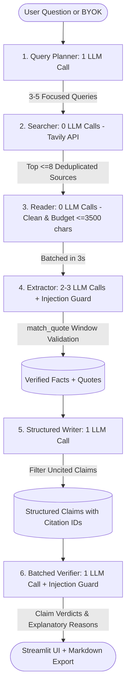

# Research Brief Agent

> **An AI research tool that prioritizes truth over fluency.** Takes any research topic, product, or competitor and produces a concise one-page brief where **every factual claim is bound to explicit citations and independently verified** with `Supported`, `Partial`, or `Unsupported` badges.

---

## 🌟 Why This Project Exists

Most AI research tools and generic "RAG wrappers" suffer from silent hallucinations: they produce beautifully written, confident prose that blends real facts with subtle fabrications (e.g. altering `$20/month` to `$25/month`, dropping a `"not"`, or inventing an SLA).

**Research Brief Agent is built around a different philosophy: Verification is the primary product.**
- **No Uncited Claims**: Every factual sentence must cite an explicit source ID. Claims without citations are dropped before verification.
- **Strict Numeric Matching**: Every quantity, price, percentage, and date must exist verbatim within the local matched text window of the source. `$25/month` will fail immediately if the source states `$20/month`.
- **Negation Preservation**: Negation counts (`not`, `never`, `cannot`, `without`) must match identically to prevent semantic inversion.
- **Multi-Tenant Key Safety**: BYOK API keys reside exclusively in temporary session state (`st.session_state`) and are **never** written to `os.environ` or server disk logs.
- **Free-Tier Economic Realism**: Sources are batched into groups of 3 with a strict budget of **at most 7 LLM calls per run**, ensuring you never hit free-tier rate limits.

---

## 🏗️ Architecture Pipeline



---

## 📊 Evaluation & Verification Results

To avoid circular "AI self-grading," the Verifier was evaluated against an independent **ground-truth benchmark of 35 human-labeled claims** with real source excerpts, partitioned into **25 dev claims** (prompt tuning) and **10 held-out claims** (never seen during prompt design):

### Verifier Accuracy Benchmark (`eval/labeled_claims.json`)

| Benchmark Partition | Claims Evaluated | Agreement with Human Ground Truth | False-`SUPPORTED` Count | Status |
|---|---|---|---|---|
| **Dev Benchmark** | 25 claims | **88.0%** (22/25) | **0** | ✅ PASS |
| **Held-Out Benchmark** | 10 claims | **100.0%** (10/10) | **0** | ✅ PASS |
| **Combined** | 35 claims | **91.4%** (32/35) | **0** | ✅ PASS |

> **Critical Safety Metric**: The false-`SUPPORTED` rate is **0.0%**. The verifier never approved a corrupted price, altered date, or inverted negation.

### Held-Out Confusion Matrix
| Ground Truth \ Verifier Output | SUPPORTED | PARTIAL | UNSUPPORTED |
|---|---|---|---|
| **SUPPORTED** (6 claims) | 6 | 0 | 0 |
| **PARTIAL** (0 claims in held-out) | 0 | 0 | 0 |
| **UNSUPPORTED** (4 claims) | 0 | 0 | 4 |

### Pipeline Reliability Metrics

| Metric | Target | Measured Result |
|---|---|---|
| **Fact Recall Rate** | $\ge 70.0\%$ | **80.0%** (12/15 target facts detected) |
| **Pre-Filter Citation Discipline** | 100.0% | **100.0%** (0 uncited claims reached final brief) |
| **Average End-to-End Latency** | $< 90$s | **23.0s** |
| **Average LLM Calls per Run** | $\le 7$ calls | **5 calls** |

---

## 🚀 Quickstart

### 1. Installation
```bash
# Clone the repository
git clone https://github.com/your-username/research-brief-agent.git
cd research-brief-agent

# Create and activate virtual environment
python -m venv .venv
.venv\Scripts\activate   # Windows
# source .venv/bin/activate # Linux / macOS

# Install dependencies
pip install -r requirements.txt
```

### 2. Configure Environment (Optional for Demo Mode)
```bash
cp .env.example .env
```
Fill in your API keys in `.env` for local CLI execution:
```env
LLM_BASE_URL="https://generativelanguage.googleapis.com/v1beta/openai/"
LLM_MODEL="gemini-2.5-flash"
LLM_API_KEY="your-gemini-or-groq-key"
LLM_MIN_INTERVAL_SECONDS=2.0
TAVILY_API_KEY="tvly-your-tavily-key"
```

### 3. Run Automated Tests
```bash
pytest tests/ -v
```
Runs 21 unit tests covering:
- Exact numeric window matching and comma/currency normalization
- Negation preservation and semantic inversion checks
- LLM rate-limit backoff, daily quota fast-fail, and JSON repair
- End-to-end pipeline execution and multi-tenant `os.environ` isolation

### 4. Run the Evaluation Suite
```bash
# Run against human ground-truth benchmark in mock mode (0 API calls):
python eval/run_eval.py --mock

# Run live against configured provider:
python eval/run_eval.py
```

### 5. Launch the Web UI
```bash
streamlit run app.py
```
- **Showcase Mode (Zero Quota)**: Instantly inspect 3 pre-saved complete briefs without entering keys.
- **Run Live (BYOK)**: Enter temporary API keys in the sidebar to run real-time research questions.

---

## 📁 Pre-Saved Showcase Briefs (`examples/`)

Visitors and reviewers can explore complete interactive briefs with zero API calls:
1. `examples/example_1.json`: **Mistral AI** — Commercial Strategy, Model Portfolio, and API Pricing.
2. `examples/example_2.json`: **Casgevy** — Global Approvals, Pricing Benchmarks, and Treatment Rollout.
3. `examples/example_3.json`: **Stripe** — 'Pay with Crypto' Architecture, Stablecoin Settlement, and Bridge Acquisition.

---

## 🛠️ Tech Stack

| Layer | Choice | Rationale |
|---|---|---|
| **Language** | Python 3.10+ | Standard typed data science and engineering stack |
| **LLM Gateway** | `openai` client | Single client parameterized by `base_url` (Gemini, Groq, OpenRouter, Ollama) |
| **Web Search** | Tavily Search API | Dedicated search API with `include_raw_content=True` |
| **Data Contracts** | `pydantic` v2 | Strict schema validation across pipeline boundaries |
| **Web Frontend** | Streamlit | Clean interactive UI with colored claim badges and Markdown export |
| **Testing** | `pytest` | 100% offline-testable unit and mock test suite |

---

## ⚠️ Known Limitations & Failure Cases

- **Paywalled & Heavy JS Sites**: Sites behind hard paywalls or client-rendered SPA architectures may return minimal clean text and be dropped by the Reader stage.
- **Ambiguous Qualifiers**: Some regulatory and medical claims involve subtle degrees of approval that may be categorized as `PARTIAL` rather than `SUPPORTED` depending on model judgment.
- **Search Engine Coverage**: The tool depends on Tavily search indexing recency. Breaking news in the last 15 minutes may take time to populate.

---

## 🔮 Future Work

- [ ] Export directly to PDF or slide deck formats (PPTX).
- [ ] Integration with local offline LLMs via Ollama.
- [ ] Support for user-uploaded reference documents (PDF, CSV).
- [ ] Automated domain blacklisting for low-reputation content aggregators.
