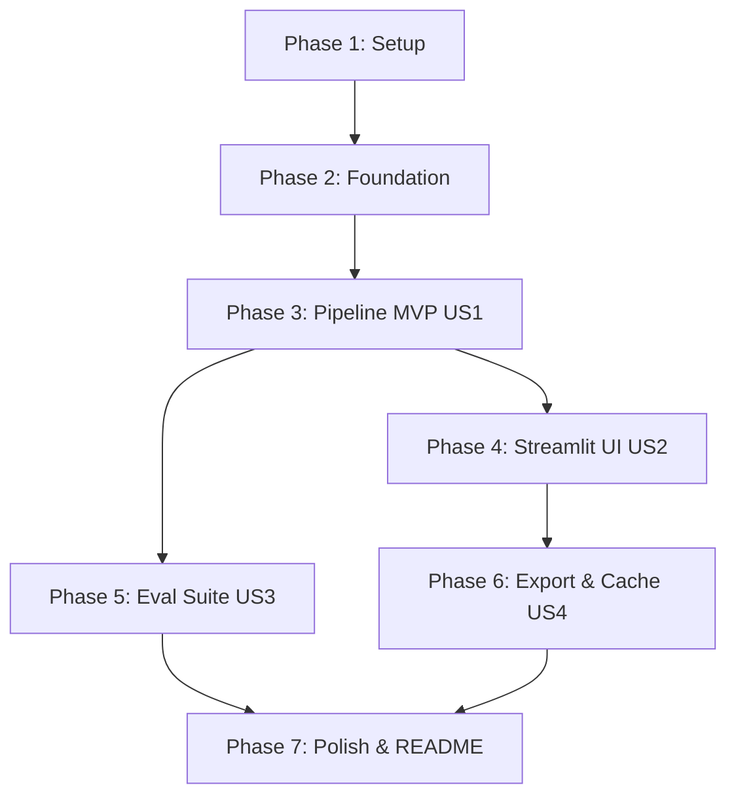

# Tasks: Research Brief Agent

**Feature**: Research Brief Agent with Per-Claim Verification, Number Exactness, and BYOK UI  
**Branch**: `001-research-brief-pipeline`  
**Input**: Design documents from `specs/001-research-brief-pipeline/` (`plan.md`, `spec.md`, `research.md`, `data-model.md`, `contracts/pipeline-api.md`)  
**Prerequisites**: Python 3.10+ virtual environment

---

## Format: `[ID] [P?] [Story] Description`
- **[P]**: Parallelizable (different files, no blocking dependency)
- **[Story]**: Associated user story (`US1`: Traceable Brief Generation, `US2`: Web UI & BYOK, `US3`: Evaluation Suite, `US4`: Markdown Export & Caching)

---

## Phase 1: Setup (Shared Infrastructure)

**Purpose**: Project initialization, dependency management, and configuration contracts.

- [x] T001 Create dependency configuration in `requirements.txt` (`openai>=1.50.0`, `pydantic>=2.7.0`, `tavily-python>=0.5.0`, `streamlit>=1.35.0`, `python-dotenv>=1.0.0`, `pytest>=8.0.0`)
- [x] T002 [P] Create environment template in `.env.example` defining `LLM_BASE_URL`, `LLM_MODEL`, `LLM_API_KEY`, `LLM_MIN_INTERVAL_SECONDS`, `TAVILY_API_KEY`
- [x] T003 [P] Create project `.gitignore` covering `.env`, `.venv/`, `__pycache__/`, `.pytest_cache/`, and cache directories
- [x] T004 Create immutable configuration classes (`LLMConfig`, `SearchConfig`) in `agent/config.py`

---

## Phase 2: Foundational (Blocking Prerequisites)

**Purpose**: Core trust mechanisms, data contracts, and client abstractions that all pipeline stages depend on.

- [x] T005 Implement typed domain models (`Source`, `Fact`, `Claim`, `BriefDraft`, `ClaimVerdict`, `FinalBrief`) in `agent/schemas.py`
- [x] T006 Implement unit tests for schemas in `tests/test_schemas.py`
- [x] T007 Implement quote verification engine with window-bounded number exactness and negation counting in `agent/match_quote.py`
- [x] T008 Implement comprehensive test cases for quote verification in `tests/test_match_quote.py` (smart quotes, number mismatches like `$25/month` vs `$20/month`, local window isolation, dropped negation words)
- [x] T009 Implement unified OpenAI-compatible client with pacing, backoff, `QuotaExhausted` fast-fail, and JSON repair fallback in `agent/llm.py`
- [x] T010 Implement client resilience tests with mocks in `tests/test_llm.py` (transient 429 backoff, daily quota exception, JSON repair)
- [x] T011 [P] Implement disk caching module for search queries and page extracts in `agent/cache.py`

**Checkpoint**: Core foundational engine and trust layers complete and 100% unit tested.

---

## Phase 3: User Story 1 - Traceable Research Brief Generation (Priority: P1) 🎯 MVP

**Goal**: An analyst enters a question; the pipeline plans queries, searches Tavily, extracts quote-verified facts, drafts structured claims, drops uncited claims, and verifies every claim with badges and one-line reasons in $\le 7$ LLM calls.

**Independent Test**: Execute `agent/pipeline.py` with mock/live input and verify returned `FinalBrief` contains 100% cited claims, all possessing `SUPPORTED`, `PARTIAL`, or `UNSUPPORTED` verdicts.

- [x] T012 [P] [US1] Create Query Planner prompt template in `prompts/planner.txt`
- [x] T013 [US1] Implement Stage 1 Query Planner in `agent/planner.py` (generates 3–5 search queries in 1 LLM call)
- [x] T014 [US1] Implement Stage 2 Searcher in `agent/search.py` (Tavily search, domain/URL deduplication, keeps top $\le 8$ sources)
- [x] T015 [US1] Implement Stage 3 Reader in `agent/reader.py` (cleans text, budgets $\le 3,500$ characters per source)
- [x] T016 [P] [US1] Create Extractor prompt template with prompt injection safety guard in `prompts/extractor.txt`
- [x] T017 [US1] Implement Stage 4 Extractor in `agent/extractor.py` (batches sources in groups of 3, runs `match_quote.py` validation, drops invalid quotes and tracks count)
- [x] T018 [P] [US1] Create Writer prompt template in `prompts/writer.txt`
- [x] T019 [US1] Implement Stage 5 Writer in `agent/writer.py` (outputs structured `BriefDraft` claims with citations; drops uncited claims and tracks count)
- [x] T020 [P] [US1] Create Verifier prompt template with prompt injection safety guard in `prompts/verifier.txt`
- [x] T021 [US1] Implement Stage 6 Verifier in `agent/verifier.py` (evaluates claims in 1 batched call against cited source quotes, returns `ClaimVerdict` list)
- [x] T022 [US1] Implement Pipeline Orchestrator in `agent/pipeline.py` (wires stages 1–6, enforces $\le 7$ call budget, reports stage progress)
- [x] T023 [US1] Implement end-to-end mocked pipeline test in `tests/test_pipeline_mock.py` asserting $\le 7$ calls, pre-filter uncited drop, and asserting `os.environ` is unmodified

**Checkpoint**: User Story 1 (Core Pipeline MVP) is fully functional and verifiable via automated tests.

---

## Phase 4: User Story 2 - Interactive Web UI with BYOK & Zero-Quota Showcase (Priority: P1)

**Goal**: Deliver a polished Streamlit interface allowing visitors to explore 3 pre-saved complete briefs without entering API keys, or run live queries with BYOK keys stored strictly in session state.

**Independent Test**: Run `streamlit run app.py`; verify pre-saved briefs load instantly with 0 API calls; verify BYOK live query executes without writing to `os.environ`.

- [x] T024 [P] [US2] Create Mistral AI showcase brief in `examples/example_1.json` with timestamp and model metadata
- [x] T025 [P] [US2] Create CRISPR Casgevy showcase brief in `examples/example_2.json` with timestamp and model metadata
- [x] T026 [P] [US2] Create Stripe Crypto showcase brief in `examples/example_3.json` with timestamp and model metadata
- [x] T027 [US2] Implement Streamlit frontend in `app.py` with sidebar mode switcher (Example Briefs vs. Run Live)
- [x] T028 [US2] Implement BYOK configuration inputs in `app.py` passing credentials strictly into `LLMConfig` in `st.session_state`
- [x] T029 [US2] Implement brief rendering in `app.py` displaying summary strip, claim verdict badges (🟢/🟡/🔴), expandable quotes, and sources table
- [x] T030 [US2] Implement user-friendly error dialogs in `app.py` for `QuotaExhausted`, rate limits, and thin sources

---

## Phase 5: User Story 3 - Independent Ground-Truth Evaluation Suite (Priority: P2)

**Goal**: Provide an automated evaluation harness measuring verifier agreement against 35 human-labeled claims (25 dev / 10 held-out) and measuring fact recall across 10 reference questions.

**Independent Test**: Run `python eval/run_eval.py` and inspect printed agreement rate, confusion matrix, false-`SUPPORTED` count, and fact recall metrics.

- [x] T031 [P] [US3] Create benchmark questions dataset in `eval/questions.json` with 10 questions and expected ground-truth facts
- [x] T032 [P] [US3] Create hand-labeled benchmark dataset in `eval/labeled_claims.json` with 35 claims (25 dev / 10 held-out)
- [x] T033 [P] [US3] Document labeling criteria and ground-truth decisions in `eval/labeling_guide.md`
- [x] T034 [US3] Implement evaluation runner in `eval/run_eval.py` calculating verifier accuracy, confusion matrix, citation rate, and fact recall

---

## Phase 6: User Story 4 - Markdown Export & Caching (Priority: P3)

**Goal**: Allow analysts to export generated briefs as clean Markdown and use disk caching for repeat research queries.

**Independent Test**: Click "Download as Markdown" in `app.py` and inspect downloaded file; run repeat search in `agent/search.py` and verify disk cache hit.

- [x] T035 [US4] Implement Markdown export serialization helper in `agent/schemas.py` and download button in `app.py`
- [x] T036 [US4] Integrate cache read/write toggle in `agent/search.py` and `agent/reader.py`

---

## Phase 7: Polish & Documentation

**Purpose**: Final project documentation, repository cleanliness, and deployment instructions.

- [x] T037 Author production `README.md` with pipeline diagram, demo showcase, evaluation results table, known limitations, and deployment guide
- [x] T038 Execute complete test suite (`pytest tests/ -v`) to confirm 100% test pass rate

---

## Dependencies & Execution Sequence

